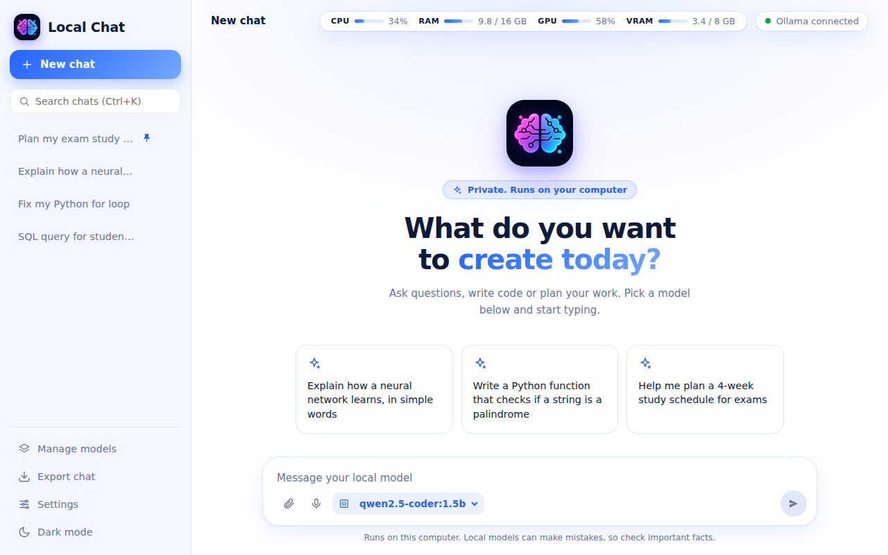
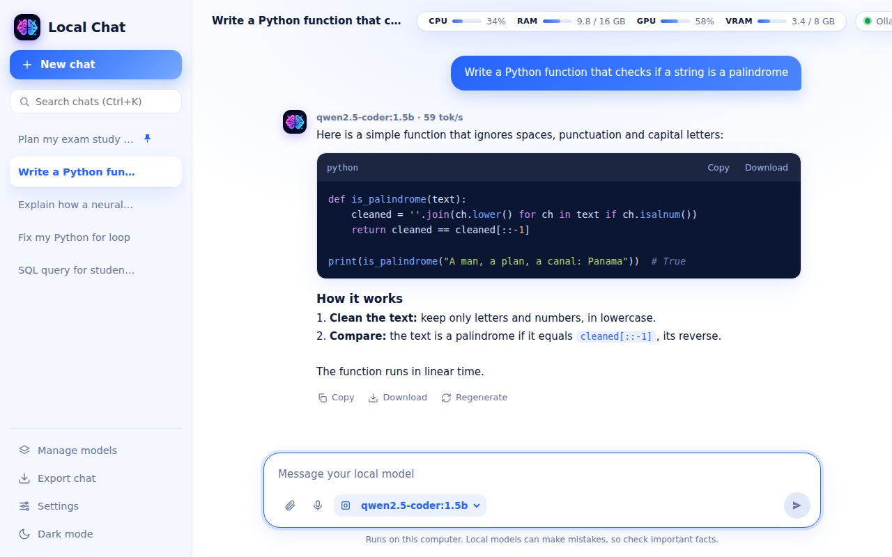
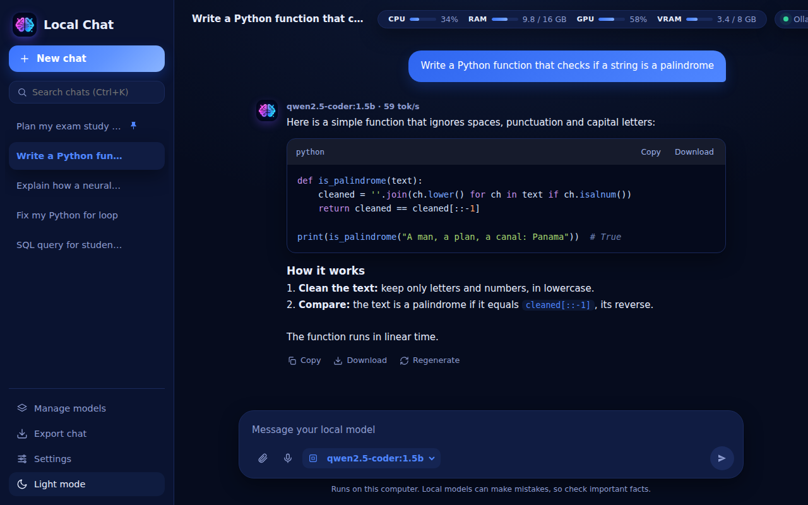

# Local Chat

<div align="center">
  

  <p><strong>A polished Windows desktop chat client for local Ollama models.</strong></p>

  <p>
    
    
    
    
  </p>
</div>

Local Chat is a native-feeling desktop interface for running private AI conversations with local language models. It uses a lightweight Python launcher, a `pywebview` desktop window, and a plain HTML/CSS/JavaScript frontend that talks directly to the local Ollama API.

The goal is simple: a fast, clean, local-first chat experience without Electron, cloud accounts, or a required build step.

## Screenshots



| Chat and Code Output | Dark Mode |
| --- | --- |
|  |  |


## Highlights

- Native desktop window powered by `pywebview`
- Direct streaming from Ollama at `http://127.0.0.1:11434`
- Local chat history with search, pinning, rename, delete, and export
- In-app model management for listing, downloading, and deleting models
- Image attachments for vision-capable Ollama models
- Text and code file attachments inserted into prompts
- Drag-and-drop, paste, and file-picker attachment support
- Markdown-style answer rendering with offline code highlighting
- Copy and download controls for generated code blocks
- Stop generation, regenerate, and edit-and-resend workflows
- Global system prompt and temperature controls
- Light and dark themes
- Optional browser speech recognition voice input
- CPU, RAM, GPU, and VRAM meters when supported by the host system

## Tech Stack

| Layer | Technology |
| --- | --- |
| Desktop shell | Python, `pywebview` |
| Local model runtime | Ollama |
| Frontend | HTML, CSS, JavaScript |
| System stats | `psutil`, `nvidia-smi`, Windows performance counters |
| Storage | WebView local storage inside the local app profile |

## Project Structure

```text
.
|-- connect_to_ollama.py   # Python launcher, Ollama process manager, pywebview bridge
|-- index.html             # Desktop app markup and UI structure
|-- styles.css             # Visual design, layout, responsive styles, and themes
|-- app.js                 # Chat state, Ollama API calls, attachments, settings, and UI behavior
|-- logo.ico               # Windows window/taskbar icon
|-- logo.png               # Project logo
|-- assets/                # README screenshots and project images
`-- local_chat_data/       # Generated WebView profile and local app data
```

`local_chat_data/` is runtime data created by the desktop WebView. It can include browser cache, local storage, cookies, and saved app state. Do not publish it to GitHub.

## Requirements

- Windows 10 or later
- Python 3.10 or later
- Ollama installed and available as `ollama.exe` in `PATH`
- Microsoft Edge WebView2 Runtime
- Python packages:
  - `ollama`
  - `pywebview`
  - `psutil` for CPU and RAM meters, optional but recommended

## Quick Start

1. Install Ollama from [ollama.com](https://ollama.com/).

2. Clone this repository and open PowerShell in the project folder.

3. Create and activate a virtual environment:

   ```powershell
   py -m venv .venv
   .\.venv\Scripts\Activate.ps1
   ```

4. Install Python dependencies:

   ```powershell
   python -m pip install --upgrade pip
   python -m pip install ollama pywebview psutil
   ```

5. Start Local Chat:

   ```powershell
   python connect_to_ollama.py
   ```

6. Download a model from **Manage models**, or install one from a terminal:

   ```powershell
   ollama pull llama3.2
   ```

After a model is installed, select it in the model picker and start chatting.

## How It Works

`connect_to_ollama.py` starts `ollama.exe serve` silently with `OLLAMA_ORIGINS=*`, then opens `index.html` in a `pywebview` desktop window.

The frontend communicates with Ollama's local HTTP API for:

- Checking connection status
- Listing installed models
- Pulling new models
- Deleting installed models
- Warming the selected model
- Streaming chat responses

The Python layer handles desktop-only capabilities:

- Starts and stops the Ollama process when appropriate
- Unloads active models on shutdown to free memory
- Provides CPU, RAM, GPU, and VRAM metrics to the UI
- Opens native save dialogs for exported chats and code blocks
- Applies the Windows taskbar and window icon
- Preserves the WebView profile across app launches

## Usage Notes

- Chat history is stored locally in the WebView profile under `local_chat_data/`.
- The launcher clears WebView cache folders on startup so frontend edits appear without deleting saved chats.
- Image attachments are downscaled before storage to keep local chat data smaller.
- Text and code attachments are truncated at 60,000 characters before being sent to the model.
- Vision attachments require an Ollama model that supports images.
- Voice input depends on speech recognition support in the embedded WebView.

## Development

There is no frontend build step. Edit `index.html`, `styles.css`, or `app.js`, then restart:

```powershell
python connect_to_ollama.py
```

The launcher currently has `DEBUG = True`, which adds the loaded `index.html` path to the window title. Set it to `False` in `connect_to_ollama.py` before packaging or sharing a polished build.

## Publishing Checklist

Before publishing this project on GitHub:

- Add a `.gitignore` entry for `local_chat_data/`.
- Remove any already-tracked WebView profile files from the repository index:

  ```powershell
  git rm -r --cached local_chat_data
  ```

- Review `local_chat_data/` locally before deleting or untracking it, because it may contain saved chats or WebView profile data.
- Add a `LICENSE` file if you want others to reuse or contribute under clear terms.
- Consider adding a `requirements.txt` for repeatable installs:

  ```powershell
  python -m pip freeze > requirements.txt
  ```

## Troubleshooting

### Ollama shows as offline

Make sure Ollama is installed and available in `PATH`:

```powershell
ollama --version
```

If needed, start Ollama manually:

```powershell
ollama serve
```

Then restart Local Chat.

### No models appear in the selector

Download a model from **Manage models** or run:

```powershell
ollama pull llama3.2
```

### Python cannot import a dependency

Install the required packages in the active environment:

```powershell
python -m pip install ollama pywebview psutil
```

### GPU or VRAM meters do not appear

NVIDIA metrics use `nvidia-smi`. AMD and Intel systems fall back to Windows performance counters and may only show utilization. If no compatible counter is available, Local Chat hides the GPU-specific meters.

### The UI does not update after editing files

Restart the Python app. The launcher clears WebView cache folders while preserving local chat history.

## Privacy

Local Chat is designed for local model execution. Prompts, responses, settings, and chat history are stored on the same computer through the WebView profile. Network access is only required when downloading Ollama models or when a selected local model/tooling performs its own external requests.

## Roadmap Ideas

- Add a `requirements.txt`
- Add packaging instructions for a distributable Windows executable
- Add automated smoke tests for the Python launcher and frontend API calls
- Add import/export support for complete chat history backups
- Expand cross-platform support for macOS and Linux

## Contributing

Contributions are welcome. For larger changes, open an issue first so the approach can be discussed before implementation.
